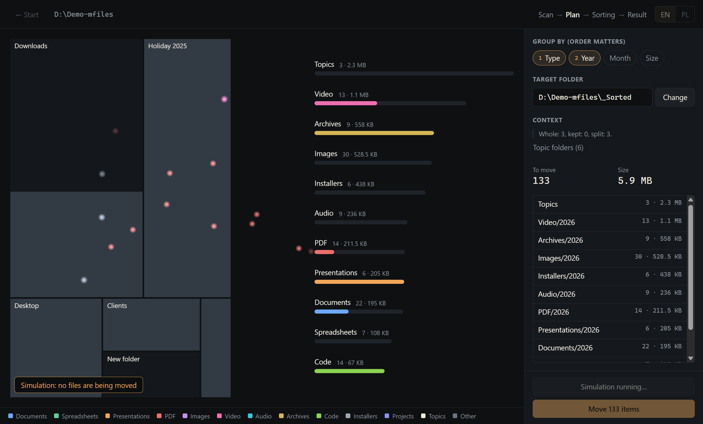
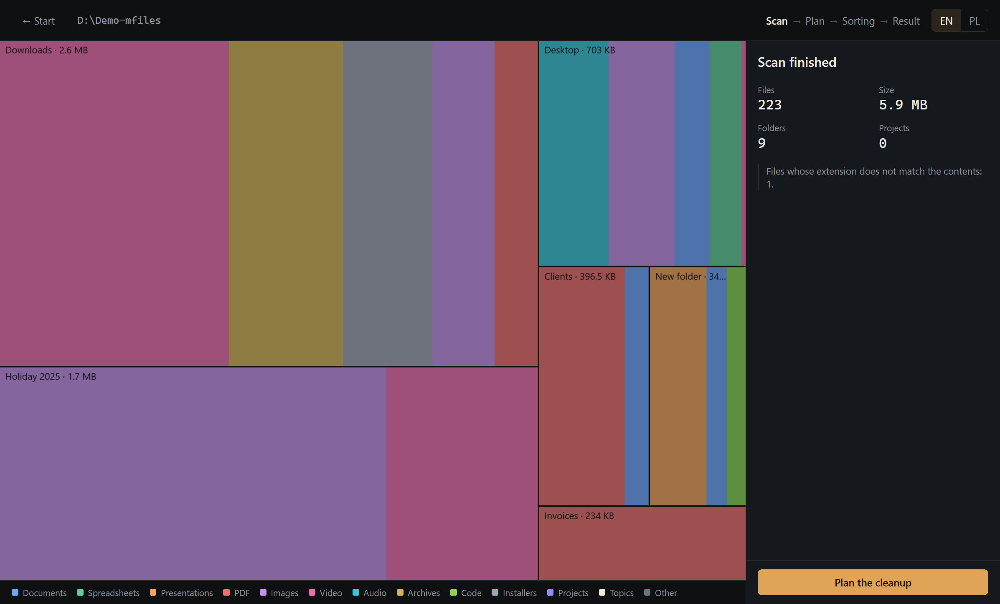
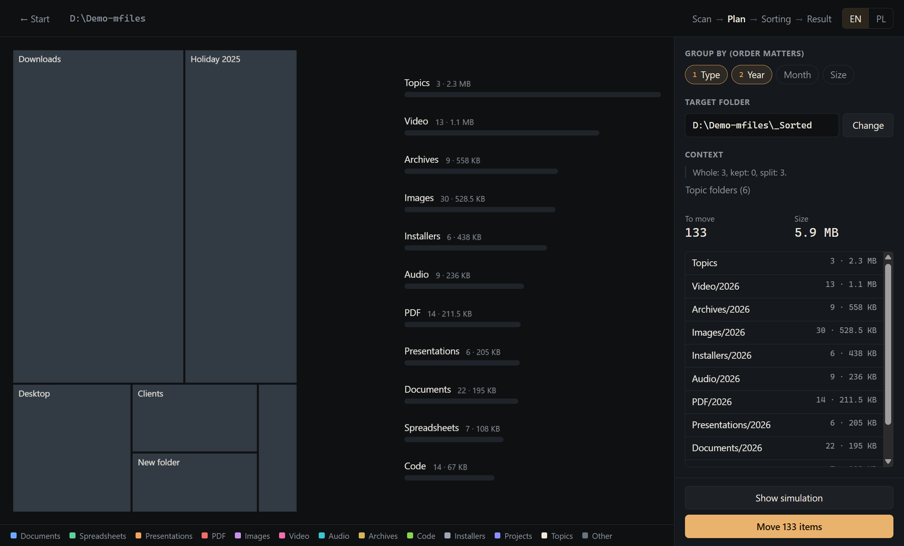
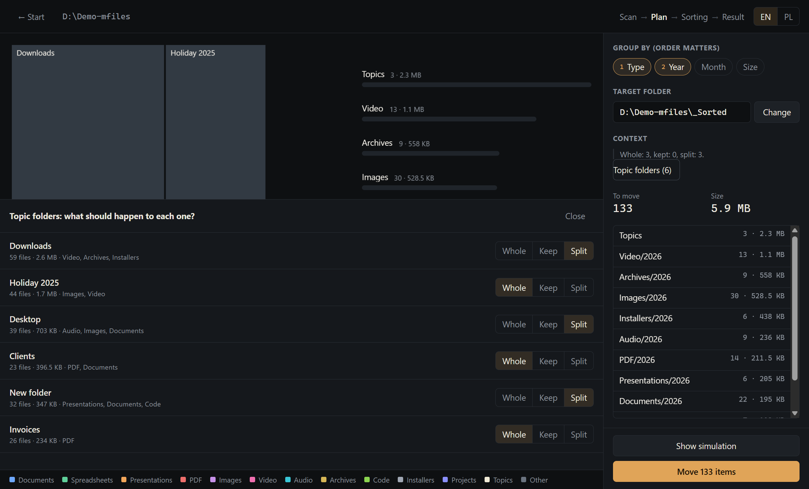

# Mfiles

[](https://github.com/kimbek7/mfiles/actions/workflows/ci.yml)
[](LICENSE)


Organize a messy folder or a whole drive, and watch it happen. Mfiles maps what you have, shows exactly what it would change, and moves files only after you approve. Every move can be undone.



## Features

- **Live map:** the scan builds a treemap of your folders, colored by file type.
- **Preview first:** group by type, year, month and size in any order, and review every path before and after. Nothing changes on disk until you confirm.
- **Keeps context:** a folder with a meaningful name moves as a whole instead of being scattered across file types.
- **Finds real file types:** content detection catches wrong extensions, and photos are dated from EXIF.
- **Finds duplicates:** identical files are verified by hash and set aside, never deleted.
- **Full undo:** available right away and later from the history, even after a restart or a crash.
- **English and Polish:** switch with the `EN | PL` control. The choice also names the folders the app creates.

| Scan | Plan | Topic folders |
|---|---|---|
|  |  |  |

## Download

Get the installer or the portable version from [Releases](https://github.com/kimbek7/mfiles/releases). Builds are not code-signed, so Windows SmartScreen shows a warning on first launch.

Try it on a copy of a folder first.

## How context is preserved

```
Clients/Smith/contract.pdf        _Sorted/
Clients/Smith/scan.jpg       →      Topics/Clients/Smith/contract.pdf
Downloads/invoice.pdf               Topics/Clients/Smith/scan.jpg
Downloads/movie.mp4                 PDF/2026/invoice.pdf
Downloads/movie.srt                 Video/2026/movie.mp4
                                    Video/2026/movie.srt
                                    _Changes-<session>.csv
```

- **Topic folders:** a folder with a meaningful name moves as a whole to `Topics`, and its contents stay unchanged.
- **Generic folders:** `Downloads`, `Desktop`, `New folder` and auto-generated names are split, and their subfolders are evaluated separately. Only loose files are grouped by type and date.
- **Your decision:** on the plan screen every folder can be set to **Whole**, **Keep** or **Split**, with an immediate preview. When organizing a whole drive, topics stay in place by default.
- **Companion files:** subtitles, photo metadata and saved page folders follow their main file.
- **Duplicates:** a copy inside a topic always wins, and only loose copies go to `_Duplicates`.
- **Change list:** a CSV in the target folder records every path before and after. Undo removes it.

Context comes only from paths and names. The app does not read document contents for this purpose, and nothing leaves your computer.

## File safety

- Nothing is overwritten: a name collision produces ` (2)`.
- Nothing is deleted, except the original after a hash-verified copy to another drive.
- Every operation is written to a journal in `%APPDATA%\Mfiles\journal` before it runs. After a crash the app offers to finish undoing.
- Folders with `.git`, `package.json`, `.sln`, `.csproj` and similar markers, and portable apps (`.exe` + `.dll`), move as a whole.
- A file changed after the plan was built, or locked by another program, is skipped and reported.
- System folders, `AppData`, symlinks and junctions are skipped. File contents are not read under OneDrive, so nothing gets downloaded from the cloud.

These rules are covered by tests that interrupt every step of sorting and undoing, also for copies across drives. See [Testing](#testing).

## Development

Requires Windows and Node.js 22 or newer.

```
npm install
npm run dev
```

| Command | Purpose |
|---|---|
| `npm run dev` | run the app with hot reload |
| `npm run build` | build the app into `out/` |
| `npm run dist` | package the installer and portable `.exe` into `dist/` |
| `npm run typecheck` | check types |
| `npm run format` | format the code |

| Folder | Contents |
|---|---|
| `src/core` | logic without Electron: scan, classification, duplicates, context, plan, execution, journal |
| `src/main` | main process and the worker doing all file work |
| `src/preload` | narrow API for the interface |
| `src/shared` | contract between processes, and the English and Polish dictionaries |
| `src/renderer` | React interface and the PixiJS scene |

## Testing

```
npm test      # core logic
npm run e2e   # full path on the built app
```

Optional checks, in PowerShell:

```
$env:MFILES_SECOND_VOLUME='D:\'; npm test               # move to a real second drive
$env:MFILES_PERF=20000; npx playwright test perf.spec   # performance on real files
```

## Limitations

- Windows only.
- No custom rules, and no detection of similar but non-identical photos.
- Folder recognition relies on names and can be wrong, so every decision is visible and can be changed in the plan.
- Empty source folders remain after sorting.
- Moving flushes the journal to disk for every file. Measured throughput is about 300 files per second, so a million files would take around an hour.

## Contributing

See [CONTRIBUTING.md](CONTRIBUTING.md). To report a vulnerability, follow [SECURITY.md](SECURITY.md).

## License

[MIT](LICENSE) © Namusoft
